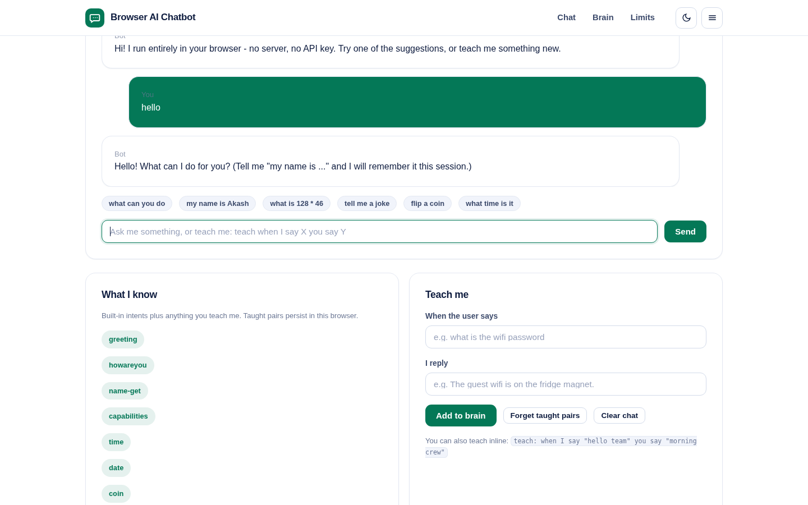
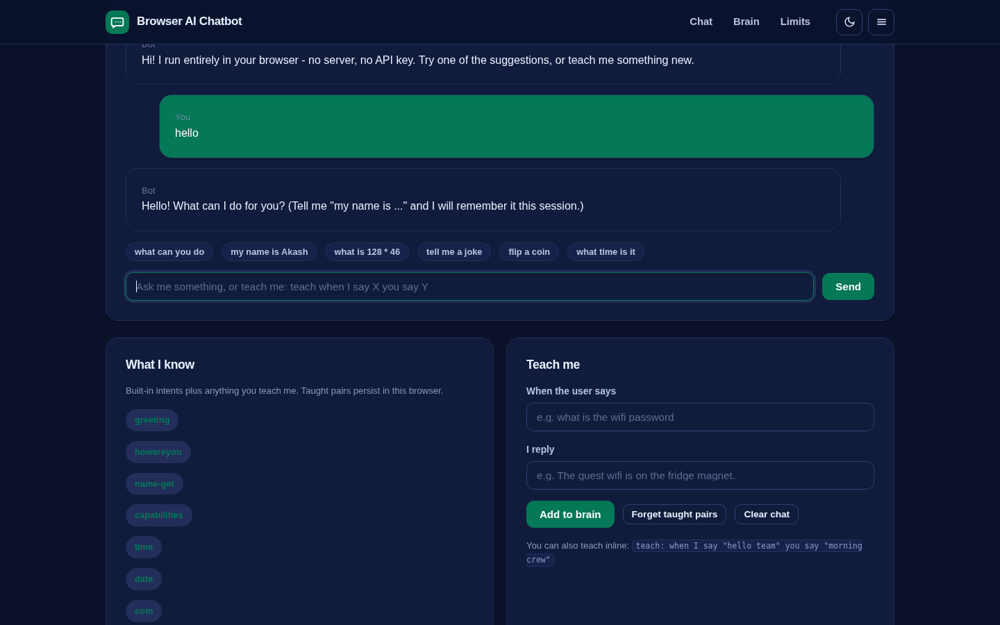
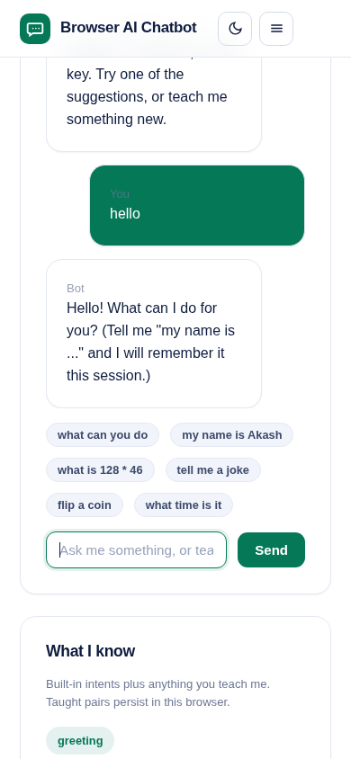

# Browser AI Chatbot

A chatbot that runs entirely in your browser - no server, no API key, no data leaving the page.

Intent matching with keyword scoring, conversation context (it remembers your name for the session), small talk, a safe math evaluator, time and date, coin flips, dice rolls, jokes - plus a teaching mode that lets you add new question-answer pairs that persist in localStorage.

**Live demo:** https://akash991833.github.io/browser-ai-chatbot/



## Features

- 15 built-in intents: greetings, capabilities, name memory, math, time/date, coin/dice, jokes, thanks, farewells, and honest answers about what it is
- Safe math evaluator: "what is 128 * 46" or "12 * (3 + 4)" - no eval of arbitrary code
- Teaching mode: add pairs via the panel or inline with `teach: when I say "ping" you say "pong"` - persisted locally
- Typing indicator, suggestion chips, clear chat
- Dark and light themes, responsive, installable PWA, works fully offline

## Honest limits

- Pattern matching, not a large language model. It answers what it was taught and handles its built-in intents; it does not reason about new topics.
- Context memory is shallow: your name and the last topic, for the session only.
- Taught pairs live in localStorage on this device only.

## Tech

Vanilla JS, no build step, no dependencies, zero network calls. Keyword-scored intent engine with regex intent matchers and a restricted-expression math evaluator.

## Run locally

```
python3 -m http.server 8064
# open http://localhost:8064
```

## Tests

```
python3 -m http.server 8064 &
node tests/run.mjs
```

76 checks across desktop and mobile, light and dark: every intent, math precedence, name context, teaching (panel + inline), taught-pair persistence across reloads, suggestion chips, chat rendering and console cleanliness.



